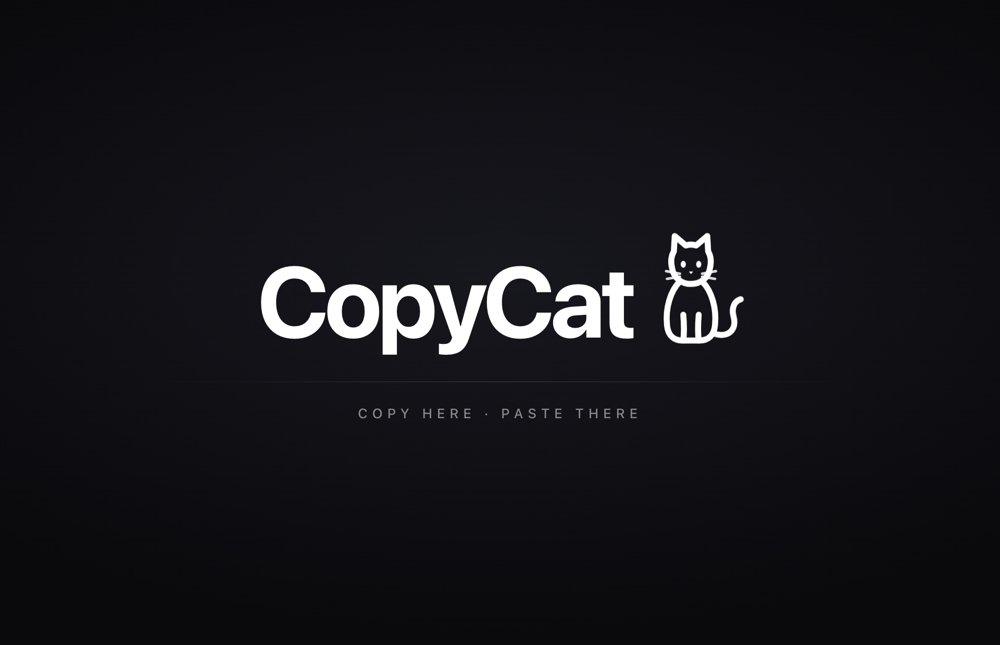
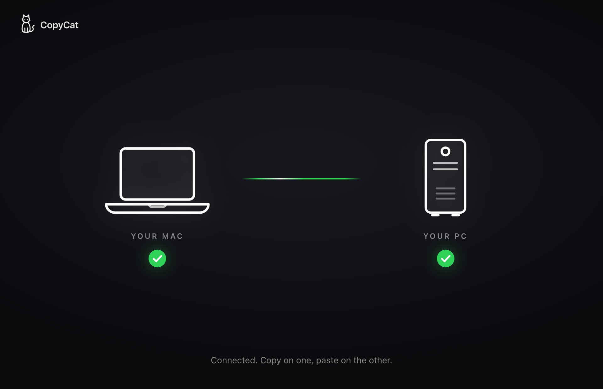

# CopyCat

Copy on your Mac, paste on your Windows PC, and the other way around. CopyCat keeps two computers' clipboards in sync over your Wi-Fi. No cloud, no account, and everything it sends is encrypted.

| Launch | Connected |
|---|---|
|  |  |

## Download

| Computer | File |
|---|---|
| Mac (Apple Silicon, M1 or newer) | [CopyCat-mac.zip](https://github.com/vhrcam/copycat/releases/latest/download/CopyCat-mac.zip) |
| Windows 10 / 11 | [CopyCat-windows.exe](https://github.com/vhrcam/copycat/releases/latest/download/CopyCat-windows.exe) |

All versions are on the [Releases page](https://github.com/vhrcam/copycat/releases).

### First launch on a Mac

1. Unzip `CopyCat-mac.zip` and drag **CopyCat** into **Applications**.
2. Open it. macOS says it can't verify the app, because CopyCat isn't signed with a paid Apple developer account. Click **Done**.
3. Open **System Settings → Privacy & Security**, scroll down to "CopyCat was blocked", and click **Open Anyway**.
4. When CopyCat asks to find devices on your local network, click **Allow**. This is how it finds your other computer.

### First launch on Windows

1. Run `CopyCat-windows.exe`.
2. If "Windows protected your PC" appears, click **More info → Run anyway**. It appears because the app isn't code-signed.
3. When Windows Firewall asks, tick **Private networks** and click **Allow**.

## Pairing

1. Open CopyCat on both computers, on the same Wi-Fi.
2. They find each other on their own and both show a 6-digit code.
3. Check that the codes match, then click **Pair** on both.

That's it. From then on the two reconnect automatically whenever both are open. Copy on one and paste on the other, and a dot travels along the line each time something syncs.

**If they don't find each other** (school and work Wi-Fi often block this): click **Connect by IP** at the bottom of one computer and type the IP shown at the bottom-left of the other.

**To stop syncing with a computer**, click **Unpair** in the bottom-right corner.

## How it works

- Each copy of CopyCat runs a small WebSocket server and announces itself on the local network with mDNS (`_copycat._tcp`), the same way AirPlay and printers are found.
- Every 0.3 seconds it checks the clipboard. New text is encrypted and sent to the paired computer, which writes it to its own clipboard.
- Text that just arrived is remembered before it's written, so it never bounces back.
- The window is HTML/CSS shown with [pywebview](https://pywebview.flowrl.com/), so the same Python code runs the app on macOS and Windows.

## Security

- Each computer creates its own key pair on first launch (X25519).
- When two computers connect, they agree on a fresh key for that session and encrypt everything with ChaCha20-Poly1305.
- The pairing code is calculated from both computers' keys. If someone on the network tried to sit in the middle, the two screens would show different codes.
- After pairing, each computer only trusts the other's exact key. A device that copies the name or the public key but doesn't have the secret key gets disconnected.
- Nothing leaves your local network. Settings live in `~/Library/Application Support/CopyCat` (Mac) or `%APPDATA%\CopyCat` (Windows): `identity.key`, `paired.json` and `copycat.log`.

## Run from source

```
python3 -m venv venv
source venv/bin/activate        # Windows: venv\Scripts\activate
pip install -r requirements.txt
python app.py
```

Run the tests:

```
pip install pytest
python -m pytest tests
```

Build the app yourself (makes `dist/CopyCat.app` on a Mac, `dist/CopyCat.exe` on Windows):

```
pip install pyinstaller
pyinstaller CopyCat.spec
```

GitHub Actions runs the tests and builds both versions on every push. Pushing a tag like `v1.0.0` publishes a release with both downloads attached.

## Limitations

- Text only (no images or files yet)
- Both computers must be on the same network
- The window has to stay open (you can minimize it). Closing it stops syncing.
- The Mac download is for Apple Silicon. Intel Macs can run it from source.
